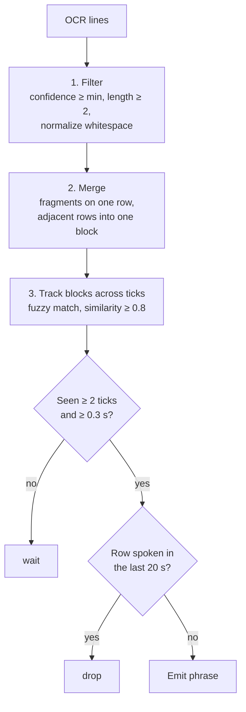
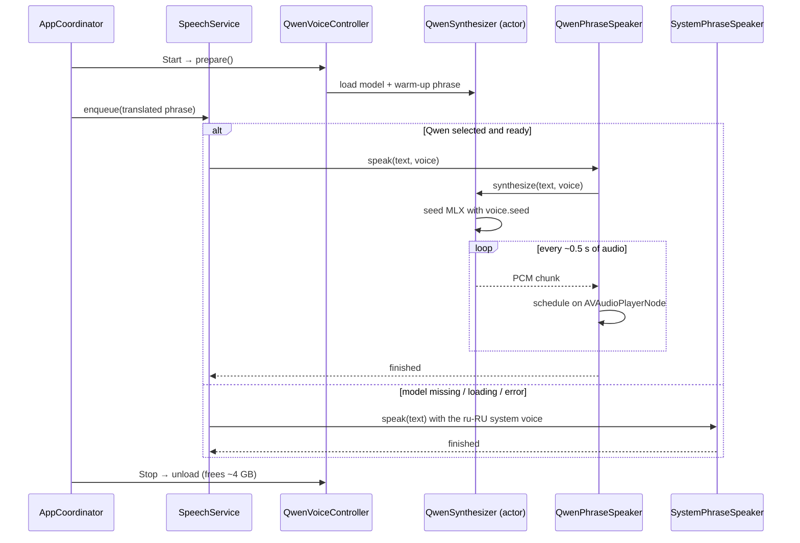
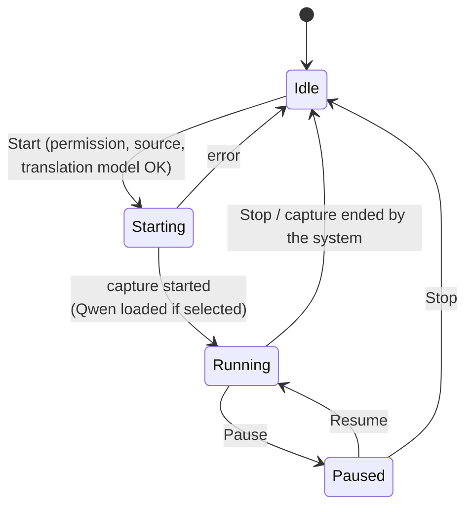
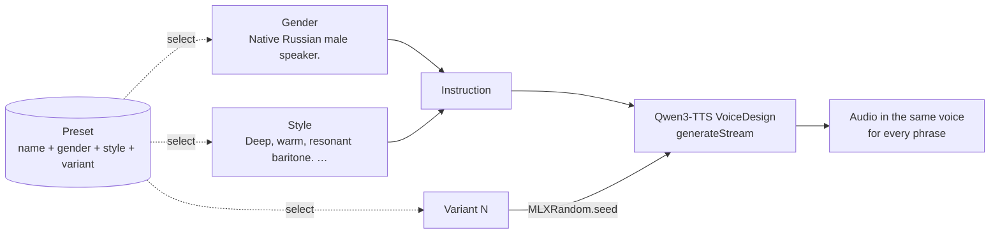

# ScreenVoice

**English** · [Русский](README.ru.md)

ScreenVoice is a native macOS app that reads subtitles (or any text) from a window or screen region, translates new lines into Russian, and speaks them aloud. Everything happens on your Mac: Apple Vision reads the text, Apple Translation translates it, and either a system voice or the **Qwen3-TTS** neural model speaks it. The original video and its sound keep playing; the Russian voice-over plays on top.

Typical use: a film, stream, or game with English subtitles, and you want to *hear* them in Russian.

> **Status:** MVP. The interface is available in English and Russian and follows your macOS language. Text is always translated into, and spoken in, Russian.

## Contents

- [Features](#features)
- [Requirements](#requirements)
- [Install and build](#install-and-build)
- [Usage](#usage)
- [Settings](#settings)
- [How it works](#how-it-works)
- [Neural voice (Qwen3-TTS)](#neural-voice-qwen3-tts)
- [Project structure](#project-structure)
- [Localization](#localization)
- [Tests](#tests)
- [Privacy](#privacy)
- [Known limitations](#known-limitations)
- [Credits and licenses](#credits-and-licenses)

## Features

- **Any source on screen:** pick an app window, draw a region (ideally just the subtitle strip), or use the whole main display.
- **Fully local:** OCR (Vision), translation (Apple Translation) and speech run on the device. No frames or text are saved or sent anywhere.
- **Two voices:**
  - **System voice:** any installed ru-RU voice (Milena, Yuri, …) via `AVSpeechSynthesizer`.
  - **Qwen3-TTS VoiceDesign:** an on-device neural voice via [MLX](https://github.com/ml-explore/mlx-swift), built from a description you write (gender, timbre, manner). It streams audio, starts speaking about 0.15 s after a line is ready (M5 Pro, Release build), and falls back to the system voice automatically.
- **Voice presets:** save a voice you like (gender, style, variant) and switch back to it later. Two narrator presets, male and female, are built in.
- **Smart de-duplication:** each line is spoken once. OCR jitter, flicker, multi-line subtitles and rolling captions don't cause repeats.
- **Stays in sync:** the speech queue is bounded and lines that waited too long are dropped, so the voice doesn't fall behind the video.
- **Speaker labels:** "Dutch: Let's go" can be spoken as just "Let's go"; the screen keeps the full line.
- **Floating panel** with the current original and translation, a history list, and a **menu-bar** control (Start / Pause / Stop).

## Requirements

| | |
|---|---|
| macOS | 26 Tahoe or later |
| Hardware | Apple silicon (M1 or later) |
| Xcode | 26 or later (to build) |
| Metal Toolchain | Required to build MLX: `xcodebuild -downloadComponent MetalToolchain` |
| Russian system voice | e.g. Milena or Yuri. Needed for the system engine and as the fallback for Qwen |
| Apple Translation model | For the chosen language pair; the app offers to download it |
| Qwen3-TTS (optional) | ~3.1 GB download, ~4 GB RAM while running |

## Install and build

There are no prebuilt releases yet; build from source.

```sh
# 1. One-time: the Metal compiler needed by MLX
xcodebuild -downloadComponent MetalToolchain

# 2. Get the code
git clone https://github.com/andrew-ignatiev/screen-voice.git
cd screen-voice
open ScreenVoice.xcodeproj
```

3. In Xcode, select the **ScreenVoice** target → **Signing & Capabilities** → choose **your Team**. The project is set to the author's team, so change it.
4. Choose the **ScreenVoice** scheme and **My Mac**, then press **Run** (⌘R). Swift packages (MLX, mlx-audio-swift) resolve on the first build; versions are pinned in `Package.resolved`.

From the terminal:

```sh
xcodebuild -project ScreenVoice.xcodeproj -scheme ScreenVoice -destination 'platform=macOS' build
```

> **Why Run uses Release:** the shared scheme launches the app in the **Release** configuration. In Debug, MLX runs slower than real time (0.63 s to first audio and 1.37× slower than playback in our measurement), so neural speech would stutter. Tests still build in Debug.

### Screen recording permission and signing

macOS ties the "Screen & System Audio Recording" permission to the app's code signature. With "Sign to Run Locally" the permission may reset after every rebuild, which is why step 3 matters. If the permission gets stuck:

```sh
tccutil reset ScreenCapture app.screenvoice.ScreenVoice
```

## Usage

1. On first launch, grant **Screen & System Audio Recording** (System Settings → Privacy & Security). macOS may ask you to relaunch the app.
2. Click **Choose Region or Window…**. Selecting only the subtitle strip gives the best speed and accuracy.
3. If a language-model warning appears, click **Download Model** and confirm. This is Apple Translation's model for the language pair.
4. Optional: choose the neural voice in **Settings → Speech → Engine → Qwen3-TTS (neural)** and click **Download**, about 3.1 GB. Then pick a voice preset or describe your own and click **Listen**.
5. Click **Start**. Translations appear in the floating panel and are spoken.
6. **Pause** pauses recognition and speech; **Stop** stops capture and unloads the neural model. **Skip Line** and **Clear Queue** control the speech queue.

The menu-bar icon (filled while capturing) offers Start / Pause / Resume / Stop, the floating-panel toggle, Settings and Quit.

## Settings

Open with **ScreenVoice → Settings…** (⌘,) or from the menu-bar icon. Settings are saved in `UserDefaults` and apply immediately, even while capturing (except the source language).

### Languages

| Setting | Values | Default | Notes |
|---|---|---|---|
| Source language | English, German, French, Spanish, Japanese | English | Locked while capturing. Support for the pair is checked at runtime |
| Target language | Russian | Russian | Fixed in the MVP |

### Speech

| Setting | Values | Default | Notes |
|---|---|---|---|
| Engine | System voice / Qwen3-TTS (neural) | System voice | Qwen falls back to the system voice while the model is missing, loading, or failing |
| Model *(Qwen)* | Download / progress / Delete | – | 3.1 GB, verified by SHA-256 |
| Voice preset *(Qwen)* | Narrator, male / Narrator, female / your saved presets | Narrator, male | Shows **Custom (not saved)** after you change the voice; see [Voices and presets](#voices-and-presets) |
| Gender *(Qwen)* | Male / Female | Male | An unedited default style switches with the gender; an edited style is kept |
| Style *(Qwen)* | Free text, in English | Audiobook narrator description | Timbre, age, accent, manner. **Reset Style** restores the default |
| Voice variant *(Qwen)* | Variant N + **Try Another** | 6 (male), 2 (female) | A different voice that fits the same description |
| Listen / Save as Preset… / Delete Preset *(Qwen)* | Buttons | – | Saved presets keep gender, style and variant; a preset with the same name is replaced |
| Voice / Fallback voice | Best installed Russian voice, or a specific ru-RU voice | Best installed | Used by the system engine, and as the fallback for Qwen |
| Speed | Slider | Normal | System: `AVSpeechUtterance` rate. Qwen: 0.5×–2× time-stretch, pitch preserved |
| Volume | 0–100 % | 100 % | Speech volume only; the video's volume is not changed |
| Don’t speak the name before a colon | On / Off | On | Doesn't speak speaker labels such as "Dutch:" |
| Max queued phrases | 1–10 | 3 | When full, the oldest waiting phrase is dropped |
| Preview *(system voice)* | Button | – | Speaks a sample phrase |

### Recognition

| Setting | Values | Default | Notes |
|---|---|---|---|
| Analysis rate | 1–10 frames/s | 4 | How often OCR runs. Lower means less CPU and a slower reaction |
| OCR mode | Accurate / Fast | Accurate | Fast is Latin-script only (Japanese always uses Accurate) |
| Min. OCR confidence | 10–90 % | 40 % | Lines below this confidence are ignored |

### Display

| Setting | Default | Notes |
|---|---|---|
| Show floating panel | On | Hiding the panel doesn't stop processing |

### Advanced (in code)

De-duplication thresholds live in `TextChangeDetector.Configuration` (`ScreenVoice/Services/OCR/TextChangeDetector.swift`):

| Parameter | Default | Meaning |
|---|---|---|
| `requiredStableFrames` | 2 | Consecutive ticks a line must be visible |
| `minimumStableDuration` | 0.3 s | Minimum time visible before it is spoken |
| `similarityThreshold` | 0.8 | Edit-distance similarity at which two texts count as the same |
| `historyLifetime` | 20 s | How long a spoken line suppresses repeats |
| `historyLimit` | 40 | How many spoken lines are remembered |
| `rowGapFactor` | 1.0 | Max gap between rows of one subtitle, in line heights |

Speech queue age limit: a phrase that waited more than **10 s** is skipped (`SpeechQueue.maxAge`).

**Speaker-label rules** (`Services/Speech/SpeakerLabelFilter.swift`): the name is one to four words, each capitalized or a number ("Dutch", "DUTCH", "Mr. Smith", "Soldier 2"). It appears at the start of the line, after a dialogue dash, or after the end of a sentence. The colon must be followed by a space, so times like "10:30" are untouched, and ordinary phrases like "I'll say: yes" stay as they are.

## How it works

### Pipeline

```mermaid
flowchart LR
    subgraph cap["Capture"]
        SC["ScreenCaptureKit<br/>window or region"] -->|latest frame only| F[(Frame slot)]
    end
    subgraph rec["Recognition loop"]
        F --> OCR["Vision OCR<br/>VNRecognizeTextRequest"]
        OCR --> TCD["TextChangeDetector<br/>filter · merge rows · track<br/>stability · de-dup"]
    end
    subgraph tra["Translation loop"]
        TCD -->|confirmed phrase| BQ[(Bounded buffer<br/>newest N)]
        BQ --> TR["Apple Translation<br/>TranslationSession"]
    end
    TR -->|event stream| AC["AppCoordinator<br/>main actor"]
    AC --> UI["Floating panel<br/>history · menu bar"]
    AC --> SLF["SpeakerLabelFilter"] --> SS["SpeechService<br/>bounded queue, 10 s max age"]
    SS -->|System| AV["AVSpeechSynthesizer<br/>ru-RU voice"]
    SS -->|Qwen3-TTS| QW["QwenSynthesizer<br/>MLX"] --> AE["AVAudioEngine<br/>time-stretch"]
```



Key decisions:

- **No frame backlog.** Capture overwrites a single "latest frame" slot and the OCR loop takes it at its own pace. If OCR is slow, the effective rate drops by itself instead of queuing.
- **Static screens still confirm.** ScreenCaptureKit sends no frames while the picture is unchanged, so the detector keeps ticking on the last OCR result and a subtitle on a paused video still gets confirmed.
- **The app never reads itself.** When capturing a region, ScreenVoice's own windows are excluded from the stream.
- **Stale lines are dropped.** The translation buffer and the speech queue are bounded, and a phrase older than 10 s is not spoken.
- **Translation outside SwiftUI.** On macOS 26, `TranslationSession(installedSource:target:)` is created directly for an installed pair, so translation runs in a background loop. Downloading a missing model still needs SwiftUI's `.translationTask`, so that button lives in the main window.

### Text change detection

`TextChangeDetector` is a pure value type with no clock or I/O, so it is fully unit-tested. On every tick:



### Speech engine selection



### Run states



### Concurrency

The project builds with Swift 6 and `SWIFT_STRICT_CONCURRENCY = complete`.

- UI state, `AppCoordinator`, `SpeechService` and the audio players live on the **main actor**.
- Recognition and translation run as two background tasks in `PipelineCoordinator`. Their options sit behind a `Mutex`, so settings apply on the next tick without a restart.
- `QwenSynthesizer` is an **actor** with an internal FIFO gate, so only one MLX operation (load, generation, unload) runs at a time. That also keeps each phrase's seed from being disturbed by another generation.
- `QwenVoiceController` chains loads and unloads in call order, so a quick Stop → Start can't interleave them.

## Neural voice (Qwen3-TTS)

| | |
|---|---|
| Model | [`mlx-community/Qwen3-TTS-12Hz-1.7B-VoiceDesign-8bit`](https://huggingface.co/mlx-community/Qwen3-TTS-12Hz-1.7B-VoiceDesign-8bit), revision `f90d617` (pinned) |
| Runtime | [mlx-audio-swift](https://github.com/Blaizzy/mlx-audio-swift) `624fd54` on [mlx-swift](https://github.com/ml-explore/mlx-swift) `ac4ae9a`, pinned before MLX 0.32.2, which slows Metal token generation by ~50% |
| Storage | `~/Library/Containers/app.screenvoice.ScreenVoice/Data/Library/Application Support/ScreenVoice/Models/` |
| Download | 12 files, 3.08 GB. Each file's size and SHA-256 are checked before the folder is moved into place. Resumes per file. Files of the 0.6B model used by earlier builds are deleted automatically |
| Memory | ~4 GB peak while speaking. Loaded on Start; unloaded on Stop and 2 min after a preview |

### Measured latency and quality

Apple M5 Pro, 24 GB, Release build, 0.5 s streaming chunks, standalone benchmark (no OCR or translation running):

| | 1.7B VoiceDesign 8-bit (used) | 0.6B Base 8-bit (earlier builds) |
|---|---|---|
| First audio | **0.15 s** | 0.12 s |
| Speed vs real time | ~3.5× faster | 4× faster |
| Peak memory while speaking | 3.9 GB | 2.95 GB |
| Intelligibility* | correct transcripts | 0 % word errors |
| Same voice on every phrase | **yes** (fixed seed) | no: pitch varied 111–154 Hz on the same phrase |

\* The output was transcribed with Apple's on-device ru-RU `DictationTranscriber` and compared with the input text.

One-time startup: model load ≈ 1 s plus a short warm-up phrase, so the first subtitle is as fast as the rest (without it the first phrase took 2.5 s to start).

Not used: the 808 MB "vocab-pruned" Qwen3-TTS builds from AtomGradient. Their pruning removes every Cyrillic token, so they can't speak Russian.

### Voices and presets

VoiceDesign builds a voice from a text description. ScreenVoice sends the gender line plus your style as the model's instruction, and seeds the random generator with the voice variant before every phrase:



- **Why the seed matters:** without it the model invents a new voice for every phrase, even with the same description (pitch ranged 75–212 Hz in a test). With a fixed seed the same text always gives identical audio, and the voice stays consistent across phrases.
- **Variants differ in steadiness.** In a scan of seeds 1–8, some kept an even pitch across different sentences and others drifted. The built-in presets use the steadiest: male variant 6 (~100 Hz, a baritone) and female variant 2 (~230 Hz). If a variant you like drifts on some lines, try the next one.
- **Style text** works best in English. The default is an audiobook-narrator description; the male and female defaults differ only in the timbre line.
- **Presets** are stored with the other settings in `UserDefaults`. Built-in presets can't be changed or deleted; picking one and editing anything gives a custom voice you can save under a new name.

### Behaviour details

- **Streaming:** audio is scheduled on `AVAudioPlayerNode` as 0.5 s chunks arrive, so playback starts before the line finishes generating.
- **Skip / Stop:** playback stops at once. A generation already running finishes in the background and its audio is discarded. It runs ~3.5× faster than real time, so it has usually finished anyway. This keeps the model's shared decoder state from being corrupted.
- **Speed:** Qwen3 has no speaking-rate control, so `AVAudioUnitTimePitch` stretches playback (bypassed at 1×).
- **Output device change:** the current phrase ends and the audio engine restarts on the next phrase.

## Project structure

```
ScreenVoice/
├── ScreenVoiceApp.swift              App entry: main window, Settings, menu-bar extra
├── App/
│   ├── AppCoordinator.swift          User actions, permissions, run state, Qwen lifecycle
│   ├── AppState.swift                Observable UI state
│   └── SettingsStore.swift           UserDefaults persistence
├── Models/                           AppSettings, NeuralVoice + VoicePreset, CaptureSource, RecognizedLine, TranslationResult
├── Services/
│   ├── Capture/                      CaptureService (SCStream), RegionSelector
│   ├── OCR/                          OCRService (Vision), TextChangeDetector
│   ├── Translation/                  TranslationService (availability, translation)
│   ├── Pipeline/                     PipelineCoordinator (recognition + translation loops)
│   └── Speech/
│       ├── SpeechService.swift       Queue, engine choice, pause/skip, fallback
│       ├── SystemPhraseSpeaker.swift AVSpeechSynthesizer wrapper
│       ├── SpeakerLabelFilter.swift  "Name:" stripping
│       └── Qwen/
│           ├── QwenModelStore.swift      Pinned download + SHA-256 verification
│           ├── QwenSynthesizer.swift     MLX model actor, seeded VoiceDesign streaming generation
│           ├── QwenVoiceController.swift Ordered load/unload, state for the UI
│           └── QwenPhraseSpeaker.swift   AVAudioEngine streaming playback
├── Views/                            Main window, source picker, settings, overlay, menu bar
└── Resources/
    ├── Localizable.xcstrings         String Catalog: English source + Russian translation
    └── Assets.xcassets               App icon, accent colour
ScreenVoiceTests/                     Swift Testing suites
```

Dependencies (Swift Package Manager, pinned in `ScreenVoice.xcodeproj/project.xcworkspace/xcshareddata/swiftpm/Package.resolved`): `mlx-swift` (`MLX`), `mlx-audio-swift` (`MLXAudioCore`, `MLXAudioTTS`) and their transitive packages.

## Localization

The interface is written in English (the development language) and translated with an Xcode **String Catalog**, `ScreenVoice/Resources/Localizable.xcstrings`. The app follows the macOS language: a Mac set to Russian shows the Russian interface, any other language shows English. To pick a language for this app only, use System Settings → General → Language & Region → Applications.

| Language | Status |
|---|---|
| English | Source language |
| Russian | Complete (all translatable strings) |

How strings are handled in code:

- SwiftUI literals (`Text("Start")`, `Button("Retry")`, `Label`, `Section`, `.help`) are localization keys automatically.
- Strings built outside views (status text, errors, enum names) use `String(localized:)`. A `comment:` disambiguates short words, e.g. "Paused" as a status.
- Interpolated values become format specifiers (`"In queue: %lld"`); translations use positional arguments (`%1$@`, `%2$@`) where word order may change.
- Language names come from `Locale.localizedString(forLanguageCode:)`, so the system translates them.
- Text the app *speaks* (the preview phrase) is content in the target language, and the voice description is model input in English; neither is localized.

To add a language: open `Localizable.xcstrings` in Xcode, click **+** to add the language, translate every string, and add the language code to `knownRegions` (Xcode does this when you add it in Project → Info → Localizations). Building in Xcode adds new strings to the catalog automatically.

## Tests

In Xcode: **Product → Test** (⌘U). From the terminal:

```sh
xcodebuild -project ScreenVoice.xcodeproj -scheme ScreenVoice -destination 'platform=macOS' test
```

| Suite | Covers |
|---|---|
| `TextChangeDetectorTests` | Stabilization, de-duplication, OCR jitter, multi-line merge, rolling captions, normalization |
| `PipelineTests` | Bounded speech queue, stale-phrase skipping, settings → pipeline, settings compatibility, region geometry |
| `SpeakerLabelFilterTests` | Speaker-label stripping rules |
| `LocalizationTests` | English development language, Russian translations present, format strings with arguments, system language names, spoken text stays Russian |
| `NeuralVoiceTests` | Voice description, gender switching, presets (save, replace, delete, built-ins), settings compatibility, speed mapping, model install checks, removal of old model files, plus **end-to-end**: Russian synthesis speed, identical audio for the same voice, serialized generation (these run only when the model is installed in the app container) |

## Privacy

- Only the selected window or region is captured. Frames stay in memory, and only the latest one is kept.
- No frames, recognized text or translations are written to disk or sent over the network.
- The only network traffic is model downloads: Apple's translation model (by the system) and, if you choose it, Qwen3-TTS from Hugging Face. That is why the sandboxed app has the `com.apple.security.network.client` entitlement.

## Known limitations

- Subtitles that appear word by word may be spoken in parts or repeated.
- Protected content (e.g. DRM video in Safari) may be captured as a black frame.
- The app doesn't lower the video's volume; speech plays on top.
- Latency depends on region size, analysis rate and Mac model. Qwen latency under full OCR and translation load hasn't been measured yet.
- Some voice variants drift in pitch on some sentences; the built-in presets use the steadiest ones found.
- Pronunciation of numbers, dates and abbreviations hasn't been tested systematically.
- Only English and Russian interface translations so far.

## Credits and licenses

- ScreenVoice is released under the [MIT License](LICENSE).
- [Qwen3-TTS](https://huggingface.co/Qwen) by the Qwen team (Alibaba Cloud), Apache-2.0. The model is downloaded at runtime, not bundled.
- [MLX Swift](https://github.com/ml-explore/mlx-swift) (MIT) and [mlx-audio-swift](https://github.com/Blaizzy/mlx-audio-swift) (MIT).
- The Qwen integration follows the approach of [Say It](https://github.com/callebtc/sayit) (MIT).
