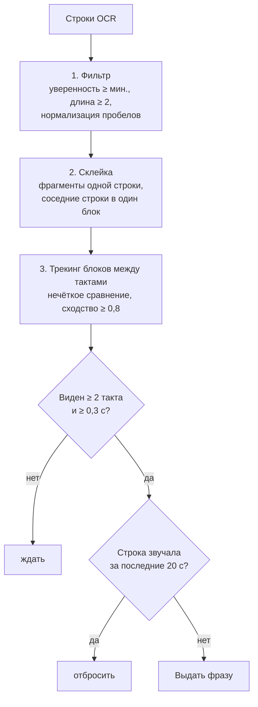
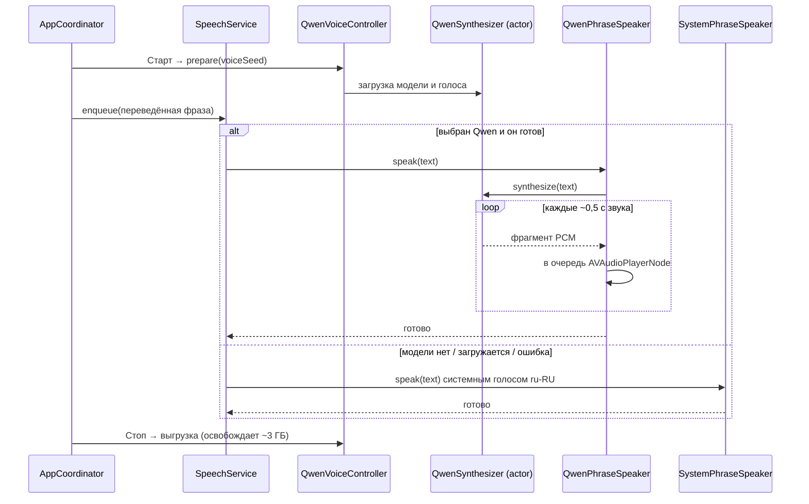
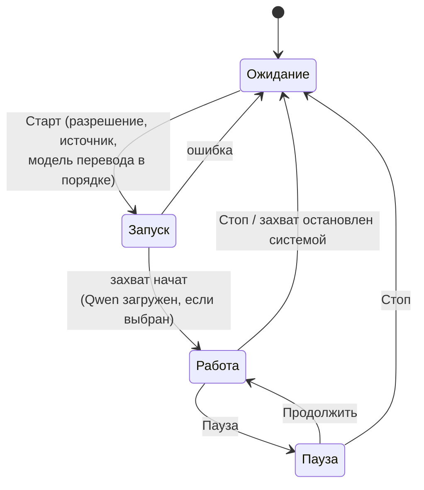
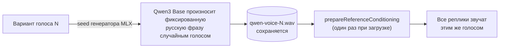

# ScreenVoice

[English](README.md) · **Русский**

ScreenVoice — нативное приложение macOS. Оно читает субтитры (или любой текст) из окна или области экрана, переводит новые реплики на русский и озвучивает их. Всё работает на вашем Mac: текст распознаёт Apple Vision, переводит Apple Translation, а озвучивает системный голос или нейросетевая модель **Qwen3-TTS**. Исходное видео и его звук продолжают воспроизводиться, русская озвучка звучит поверх.

Типичный сценарий: фильм, стрим или игра с английскими субтитрами, которые хочется *слышать* по-русски.

> **Статус:** MVP. Интерфейс на английском и русском, язык выбирается по языку macOS. Текст всегда переводится на русский и озвучивается по-русски.

## Содержание

- [Возможности](#возможности)
- [Требования](#требования)
- [Установка и сборка](#установка-и-сборка)
- [Как пользоваться](#как-пользоваться)
- [Настройки](#настройки)
- [Как это работает](#как-это-работает)
- [Нейросетевой голос (Qwen3-TTS)](#нейросетевой-голос-qwen3-tts)
- [Структура проекта](#структура-проекта)
- [Локализация](#локализация)
- [Тесты](#тесты)
- [Конфиденциальность](#конфиденциальность)
- [Известные ограничения](#известные-ограничения)
- [Авторы и лицензии](#авторы-и-лицензии)

## Возможности

- **Любой источник на экране:** окно приложения, выделенная область (лучше всего — только полоса субтитров) или весь главный экран.
- **Полностью локально:** распознавание (Vision), перевод (Apple Translation) и озвучка выполняются на устройстве. Кадры и текст не сохраняются и никуда не отправляются.
- **Два голоса:**
  - **Системный голос:** любой установленный голос ru-RU (Milena, Yuri, …) через `AVSpeechSynthesizer`.
  - **Qwen3-TTS:** локальный нейросетевой голос на [MLX](https://github.com/ml-explore/mlx-swift). Звук идёт потоком, речь начинается примерно через 0,1 с после готовности реплики (M5 Pro, сборка Release). При недоступности модели автоматически используется системный голос.
- **Умная дедупликация:** каждая реплика звучит один раз. Дрожание OCR, мерцание, многострочные и «бегущие» субтитры не вызывают повторов.
- **Синхронность с видео:** очередь озвучки ограничена, а реплики, ждавшие слишком долго, пропускаются. Голос не отстаёт от картинки.
- **Имена говорящих:** «Датч: Пошли» можно озвучить просто как «Пошли». На экране строка остаётся полной.
- **Плавающая панель** с текущим оригиналом и переводом, история реплик и управление из **строки меню** (Старт / Пауза / Стоп).

## Требования

| | |
|---|---|
| macOS | 26 Tahoe или новее |
| Компьютер | Apple Silicon (M1 и новее) |
| Xcode | 26 или новее (для сборки) |
| Metal Toolchain | Нужен для сборки MLX: `xcodebuild -downloadComponent MetalToolchain` |
| Русский системный голос | Например, Milena или Yuri. Нужен системному движку и как запасной голос для Qwen |
| Языковая модель Apple Translation | Для выбранной пары языков. Приложение предложит загрузить её само |
| Qwen3-TTS (необязательно) | Загрузка ~1,9 ГБ, ~3 ГБ памяти во время работы |

## Установка и сборка

Готовых сборок пока нет, приложение собирается из исходников.

```sh
# 1. Один раз: компилятор Metal для MLX
xcodebuild -downloadComponent MetalToolchain

# 2. Получить код
git clone https://github.com/andrew-ignatiev/screen-voice.git
cd screen-voice
open ScreenVoice.xcodeproj
```

3. В Xcode выберите таргет **ScreenVoice** → **Signing & Capabilities** → укажите **свою команду (Team)**. В проекте указана команда автора, её нужно заменить.
4. Выберите схему **ScreenVoice** и **My Mac**, нажмите **Run** (⌘R). Пакеты Swift (MLX, mlx-audio-swift) загрузятся при первой сборке. Версии закреплены в `Package.resolved`.

Из терминала:

```sh
xcodebuild -project ScreenVoice.xcodeproj -scheme ScreenVoice -destination 'platform=macOS' build
```

> **Почему Run собирает Release:** общая схема запускает приложение в конфигурации **Release**. В Debug MLX работает медленнее реального времени (по нашему замеру: первый звук через 0,63 с, синтез в 1,37 раза медленнее воспроизведения), и нейросетевая речь прерывалась бы. Тесты по-прежнему собираются в Debug.

### Разрешение на запись экрана и подпись

macOS привязывает разрешение «Запись экрана и системного звука» к подписи приложения. При локальной подписи («Sign to Run Locally») разрешение может сбрасываться после каждой пересборки, поэтому шаг 3 важен. Если разрешение «застряло»:

```sh
tccutil reset ScreenCapture app.screenvoice.ScreenVoice
```

## Как пользоваться

1. При первом запуске выдайте разрешение **«Запись экрана и системного звука»** («Системные настройки → Конфиденциальность и безопасность»). macOS может попросить перезапустить приложение.
2. Нажмите **«Выбрать область/окно…»**. Лучше всего выделить только полосу с субтитрами: так распознавание быстрее и точнее.
3. Если появилось предупреждение о языковой модели, нажмите **«Загрузить модель»** и подтвердите загрузку. Это модель Apple Translation для выбранной пары языков.
4. По желанию включите нейросетевой голос: **«Настройки → Озвучка → Движок → Qwen3-TTS»**, затем **«Загрузить»** (около 1,9 ГБ).
5. Нажмите **«Старт»**. Перевод появится в плавающей панели и будет озвучен.
6. **«Пауза»** приостанавливает распознавание и речь, **«Стоп»** останавливает захват и выгружает нейросетевую модель. **«Пропустить реплику»** и **«Очистить очередь»** управляют очередью озвучки.

Значок в строке меню (заполнен, пока идёт захват) даёт доступ к командам «Старт / Пауза / Продолжить / Стоп», переключателю плавающей панели, настройкам и выходу.

## Настройки

Откройте **ScreenVoice → Настройки…** (⌘,) или через значок в строке меню. Настройки хранятся в `UserDefaults` и применяются сразу, даже во время захвата (кроме исходного языка).

### Языки

| Настройка | Значения | По умолчанию | Примечание |
|---|---|---|---|
| Исходный язык | Английский, немецкий, французский, испанский, японский | Английский | Нельзя менять во время захвата. Поддержка пары проверяется при запуске |
| Язык перевода | Русский | Русский | Фиксирован в MVP |

### Озвучка

| Настройка | Значения | По умолчанию | Примечание |
|---|---|---|---|
| Движок | Системный голос / Qwen3-TTS (нейросеть) | Системный голос | Пока модель Qwen не загружена, загружается или выдала ошибку, звучит системный голос |
| Модель *(Qwen)* | Загрузить / прогресс / Удалить | – | 1,9 ГБ, проверка по SHA-256 |
| Голос Qwen *(Qwen)* | Вариант N + «Другой голос» | Вариант 1 | Каждый вариант — свой сгенерированный голос, см. [голос-заглушку](#голос-заглушка) |
| Голос / Запасной голос | Лучший установленный русский или конкретный голос ru-RU | Лучший установленный | Используется системным движком и как запасной для Qwen |
| Скорость | Ползунок | Обычная | Системный голос: темп `AVSpeechUtterance`. Qwen: 0,5×–2× без изменения высоты |
| Громкость | 0–100 % | 100 % | Только громкость речи, громкость видео не меняется |
| Не озвучивать имя перед двоеточием | Вкл / Выкл | Вкл | Не произносит имена говорящих вроде «Датч:» |
| Фраз в очереди не больше | 1–10 | 3 | При переполнении отбрасывается самая старая фраза |
| «Прослушать» | Кнопка | – | Произносит пример текущим движком |

### Распознавание

| Настройка | Значения | По умолчанию | Примечание |
|---|---|---|---|
| Частота анализа | 1–10 кадр/с | 4 | Как часто запускается OCR. Меньше — ниже нагрузка, но медленнее реакция |
| Режим OCR | Точная / Быстрая | Точная | Быстрый режим только для латиницы (для японского всегда точный) |
| Мин. уверенность OCR | 10–90 % | 40 % | Строки с меньшей уверенностью игнорируются |

### Отображение

| Настройка | По умолчанию | Примечание |
|---|---|---|
| Показывать плавающую панель | Вкл | Если скрыть панель, обработка продолжится |

### Расширенные (в коде)

Пороги дедупликации находятся в `TextChangeDetector.Configuration` (`ScreenVoice/Services/OCR/TextChangeDetector.swift`):

| Параметр | По умолчанию | Смысл |
|---|---|---|
| `requiredStableFrames` | 2 | Сколько тактов подряд строка должна быть видна |
| `minimumStableDuration` | 0,3 с | Минимальное время видимости до озвучки |
| `similarityThreshold` | 0,8 | Порог сходства (по расстоянию редактирования), при котором тексты считаются одинаковыми |
| `historyLifetime` | 20 с | Сколько времени не повторять уже озвученную строку |
| `historyLimit` | 40 | Сколько озвученных строк запоминается |
| `rowGapFactor` | 1,0 | Максимальный зазор между строками одного субтитра, в высотах строки |

Ограничение очереди озвучки: фраза, ждавшая дольше **10 с**, пропускается (`SpeechQueue.maxAge`).

**Правила для имён говорящих** (`Services/Speech/SpeakerLabelFilter.swift`): имя — от одного до четырёх слов, каждое с заглавной буквы или число («Датч», «ДАТЧ», «Mr. Smith», «Солдат 2»). Имя стоит в начале строки, после тире диалога или после конца предложения. После двоеточия должен идти пробел, поэтому время вроде «10:30» не затрагивается. Обычные фразы вроде «Я скажу: да» остаются как есть.

## Как это работает

### Конвейер

```mermaid
flowchart LR
    subgraph cap["Захват"]
        SC["ScreenCaptureKit<br/>окно или область"] -->|только последний кадр| F[(Слот кадра)]
    end
    subgraph rec["Цикл распознавания"]
        F --> OCR["Vision OCR<br/>VNRecognizeTextRequest"]
        OCR --> TCD["TextChangeDetector<br/>фильтр · склейка строк · трекинг<br/>стабильность · дедупликация"]
    end
    subgraph tra["Цикл перевода"]
        TCD -->|подтверждённая фраза| BQ[(Ограниченный буфер<br/>N последних)]
        BQ --> TR["Apple Translation<br/>TranslationSession"]
    end
    TR -->|поток событий| AC["AppCoordinator<br/>main actor"]
    AC --> UI["Плавающая панель<br/>история · строка меню"]
    AC --> SLF["SpeakerLabelFilter"] --> SS["SpeechService<br/>ограниченная очередь, ≤ 10 с"]
    SS -->|Системный| AV["AVSpeechSynthesizer<br/>голос ru-RU"]
    SS -->|Qwen3-TTS| QW["QwenSynthesizer<br/>MLX"] --> AE["AVAudioEngine<br/>изменение темпа"]
```



Главные решения:

- **Кадры не накапливаются.** Захват перезаписывает единственный «последний кадр», а цикл OCR забирает его в своём темпе. Если OCR не успевает, частота анализа снижается сама, без очереди.
- **Статичный экран тоже подтверждается.** ScreenCaptureKit не присылает кадры, если картинка не меняется. Детектор всё равно получает такты с последним результатом OCR, поэтому субтитр на паузе тоже подтверждается.
- **Приложение не читает само себя.** При захвате области окна ScreenVoice исключаются из потока.
- **Устаревшие фразы пропускаются.** Буфер перевода и очередь озвучки ограничены, фраза старше 10 секунд не произносится.
- **Перевод вне SwiftUI.** Начиная с macOS 26, `TranslationSession(installedSource:target:)` создаётся напрямую для установленной пары, поэтому перевод работает в фоновом цикле. Загрузка недостающей модели по-прежнему требует SwiftUI-модификатора `.translationTask`, поэтому кнопка находится в главном окне.

### Определение новых реплик

`TextChangeDetector` — чистый тип-значение без часов и ввода-вывода, поэтому он полностью покрыт тестами. На каждом такте:



### Выбор движка озвучки



### Состояния работы



### Многопоточность

Проект собирается на Swift 6 с `SWIFT_STRICT_CONCURRENCY = complete`.

- Состояние UI, `AppCoordinator`, `SpeechService` и аудиоплееры работают на **main actor**.
- Распознавание и перевод — две фоновые задачи в `PipelineCoordinator`. Их параметры защищены `Mutex`, поэтому настройки применяются на следующем такте без перезапуска.
- `QwenSynthesizer` — **actor** с внутренней FIFO-очередью: одновременно выполняется только одна операция MLX (загрузка, подготовка голоса, генерация, выгрузка).
- `QwenVoiceController` выполняет загрузки и выгрузки строго по порядку, поэтому быстрые «Стоп → Старт» не пересекаются.

## Нейросетевой голос (Qwen3-TTS)

| | |
|---|---|
| Модель | [`mlx-community/Qwen3-TTS-12Hz-0.6B-Base-8bit`](https://huggingface.co/mlx-community/Qwen3-TTS-12Hz-0.6B-Base-8bit), ревизия `50f45ef` (закреплена) |
| Среда | [mlx-audio-swift](https://github.com/Blaizzy/mlx-audio-swift) `624fd54` на [mlx-swift](https://github.com/ml-explore/mlx-swift) `ac4ae9a`. Версия закреплена до MLX 0.32.2, которая замедляет генерацию на Metal примерно на 50% |
| Хранение | `~/Library/Containers/app.screenvoice.ScreenVoice/Data/Library/Application Support/ScreenVoice/Models/` |
| Загрузка | 12 файлов, 1,99 ГБ. Размер и SHA-256 каждого файла проверяются до переноса папки на место. Загрузка продолжается с того файла, на котором прервалась |
| Память | До ~3 ГБ, пока модель загружена. Загружается при «Старте», выгружается при «Стопе» и через 2 минуты после прослушивания |

### Замеры задержки и качества

Apple M5 Pro, 24 ГБ, сборка Release, 20 типичных русских реплик из субтитров, потоковые фрагменты по 0,5 с, отдельный тест производительности (без параллельных OCR и перевода):

| Вариант | Первый звук | Вся реплика (медиана / макс.) | Скорость относительно реального времени | Пик памяти | Доля ошибок в словах* |
|---|---|---|---|---|---|
| **8-bit (используется)** | **0,12 с** | 0,56 / 0,85 с | в 4 раза быстрее | 2,95 ГБ | **0 %** |
| 4-bit | 0,10 с | 0,45 / 0,64 с | в 4,8 раза быстрее | 2,67 ГБ | 0,9 % |

\* Звук распознан локальным `DictationTranscriber` Apple для ru-RU и сравнён с исходным текстом.

Однократный запуск: загрузка модели ≈ 1,3 с, подготовка голоса ≈ 1,9 с.

Не используются: «урезанные по словарю» сборки Qwen3-TTS на 808 МБ от AtomGradient. При урезании из словаря удалены все кириллические токены, и русский они произнести не могут.

### Голос-заглушка

Базовая модель клонирует любой голос, который получает как образец. Пока нет специально подобранного голоса, ScreenVoice создаёт его сам:



Один и тот же номер варианта всегда даёт один и тот же голос. Кнопка «Другой голос» переключает на следующий вариант.

### Детали поведения

- **Потоковое воспроизведение:** звук ставится в очередь `AVAudioPlayerNode` по мере поступления фрагментов по 0,5 с, поэтому речь начинается до окончания генерации реплики.
- **Пропуск / Стоп:** воспроизведение останавливается сразу. Уже начатая генерация доходит до конца в фоне, её звук отбрасывается. Генерация в ~4 раза быстрее реального времени, поэтому обычно к этому моменту она уже закончена. Так общее состояние декодера модели не повреждается.
- **Скорость:** у Qwen3 нет управления темпом речи, поэтому темп воспроизведения меняет `AVAudioUnitTimePitch` (на 1× он отключён).
- **Смена устройства вывода:** текущая реплика завершается, а аудиодвижок перезапускается на следующей.

## Структура проекта

```
ScreenVoice/
├── ScreenVoiceApp.swift              Точка входа: главное окно, настройки, значок в строке меню
├── App/
│   ├── AppCoordinator.swift          Действия пользователя, разрешения, состояние, жизненный цикл Qwen
│   ├── AppState.swift                Наблюдаемое состояние UI
│   └── SettingsStore.swift           Хранение настроек в UserDefaults
├── Models/                           AppSettings, CaptureSource, RecognizedLine, TranslationResult
├── Services/
│   ├── Capture/                      CaptureService (SCStream), RegionSelector
│   ├── OCR/                          OCRService (Vision), TextChangeDetector
│   ├── Translation/                  TranslationService (доступность, перевод)
│   ├── Pipeline/                     PipelineCoordinator (циклы распознавания и перевода)
│   └── Speech/
│       ├── SpeechService.swift       Очередь, выбор движка, пауза/пропуск, запасной голос
│       ├── SystemPhraseSpeaker.swift Обёртка над AVSpeechSynthesizer
│       ├── SpeakerLabelFilter.swift  Удаление «Имя:»
│       └── Qwen/
│           ├── QwenModelStore.swift      Закреплённая загрузка и проверка SHA-256
│           ├── QwenSynthesizer.swift     Actor модели MLX, голос, потоковая генерация
│           ├── QwenVoiceController.swift Загрузка/выгрузка по порядку, состояние для UI
│           └── QwenPhraseSpeaker.swift   Потоковое воспроизведение через AVAudioEngine
├── Views/                            Главное окно, выбор источника, настройки, панель, строка меню
└── Resources/
    ├── Localizable.xcstrings         Каталог строк: английский оригинал и русский перевод
    └── Assets.xcassets               Иконка, цвет акцента
ScreenVoiceTests/                     Тесты Swift Testing
```

Зависимости (Swift Package Manager, версии закреплены в `ScreenVoice.xcodeproj/project.xcworkspace/xcshareddata/swiftpm/Package.resolved`): `mlx-swift` (`MLX`), `mlx-audio-swift` (`MLXAudioCore`, `MLXAudioTTS`) и их зависимости.

## Локализация

Интерфейс написан на английском (язык разработки) и переводится через **String Catalog** Xcode: `ScreenVoice/Resources/Localizable.xcstrings`. Приложение следует языку macOS: на Mac с русским языком интерфейс русский, на любом другом — английский. Язык только для этого приложения можно выбрать в «Системные настройки → Основные → Язык и регион → Приложения».

| Язык | Состояние |
|---|---|
| Английский | Исходный язык |
| Русский | Полностью (123 из 123 строк) |

Как строки устроены в коде:

- Строковые литералы SwiftUI (`Text("Start")`, `Button("Retry")`, `Label`, `Section`, `.help`) автоматически становятся ключами локализации.
- Строки вне представлений (статус, ошибки, названия вариантов) используют `String(localized:)`. Параметр `comment:` уточняет смысл коротких слов, например «Paused» как статус.
- Подставляемые значения становятся спецификаторами формата (`"In queue: %lld"`). В переводах используются позиционные аргументы (`%1$@`, `%2$@`), если порядок слов может меняться.
- Названия языков берутся из `Locale.localizedString(forLanguageCode:)`, их переводит система.
- Текст, который приложение *произносит* (фраза для прослушивания, образец голоса Qwen), — это содержимое на языке перевода, и он намеренно не локализуется.

Чтобы добавить язык: откройте `Localizable.xcstrings` в Xcode, нажмите **+**, добавьте язык и переведите все строки. Код языка должен попасть в `knownRegions` (Xcode добавит его сам, если добавить язык в Project → Info → Localizations). При сборке в Xcode новые строки попадают в каталог автоматически.

## Тесты

В Xcode: **Product → Test** (⌘U). Из терминала:

```sh
xcodebuild -project ScreenVoice.xcodeproj -scheme ScreenVoice -destination 'platform=macOS' test
```

| Набор | Что проверяет |
|---|---|
| `TextChangeDetectorTests` | Стабилизацию, дедупликацию, дрожание OCR, склейку многострочных субтитров, «бегущие» субтитры, нормализацию |
| `PipelineTests` | Ограниченную очередь озвучки, пропуск устаревших фраз, применение настроек к конвейеру, совместимость настроек, координаты области |
| `SpeakerLabelFilterTests` | Правила удаления имён говорящих |
| `LocalizationTests` | Английский язык разработки, наличие русских переводов, строки формата с аргументами, системные названия языков, произносимый текст остаётся русским |
| `NeuralVoiceTests` | Настройки движка, пересчёт скорости, проверку установленной модели, а также **сквозной синтез русской речи** и последовательную генерацию (эти два теста запускаются, только если модель установлена в контейнере приложения) |

## Конфиденциальность

- Захватывается только выбранное окно или область. Кадры хранятся в памяти, и только последний.
- Кадры, распознанный текст и переводы не записываются на диск и не отправляются в сеть.
- Сеть используется только для загрузки моделей: модели перевода Apple (её загружает система) и, если вы её выбрали, Qwen3-TTS с Hugging Face. Поэтому у приложения в песочнице есть право `com.apple.security.network.client`.

## Известные ограничения

- Субтитры, которые проявляются по слову, могут озвучиваться частями или повторно.
- Защищённое содержимое (например, видео с DRM в Safari) может захватываться как чёрный кадр.
- Громкость видео приложение не меняет: речь звучит поверх.
- Задержка зависит от размера области, частоты анализа и модели Mac. Задержка Qwen при полной нагрузке OCR и перевода ещё не измерена.
- Голос Qwen — сгенерированная заглушка. Специально подобранный русский голос запланирован.
- Пока есть только английский и русский интерфейс.

## Авторы и лицензии

- ScreenVoice распространяется по [лицензии MIT](LICENSE).
- [Qwen3-TTS](https://huggingface.co/Qwen) — команда Qwen (Alibaba Cloud), Apache-2.0. Модель загружается во время работы и не входит в репозиторий.
- [MLX Swift](https://github.com/ml-explore/mlx-swift) (MIT) и [mlx-audio-swift](https://github.com/Blaizzy/mlx-audio-swift) (MIT).
- Интеграция Qwen следует подходу [Say It](https://github.com/callebtc/sayit) (MIT).
